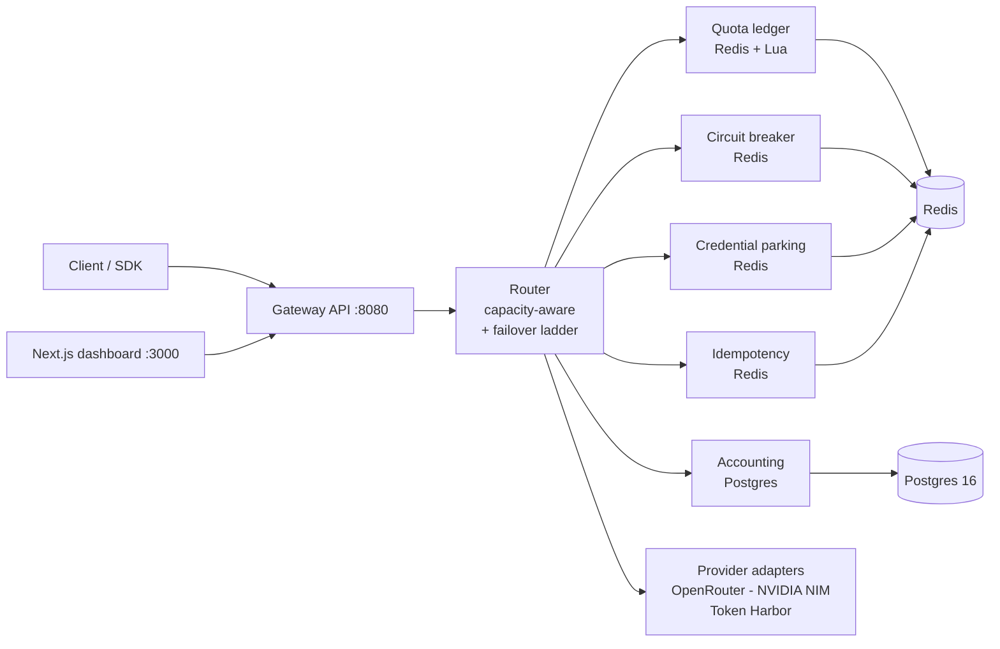

# LLM Gateway (BYOK)

> One OpenAI-compatible endpoint in front of **a pool of provider API keys you already own** — rate-limit-aware routing, per-credential quota ledgers, automatic failover, and several keys per provider.


## Why this exists

Hosted LLM APIs throttle per *account*: one key is usually one strong model at roughly one request every couple of seconds, and the ceiling, window and reset behaviour differ per provider, per model, and change without notice. The usual workarounds are all bad — sleep and retry, hardcode a second provider, or keep five keys in five `.env` files and forget which is exhausted.

This gateway turns the keys you already own, across several providers, into one endpoint with pooled capacity: budget tracked per `(credential, model, window)`, each request routed to a target that still has headroom, load spread so no key idles while another is spent, and `429` failover on the provider's own `Retry-After`. **Rate limits are never hardcoded** — a numeric RPM in the source would be wrong by the end of the quarter.


## Features

| Feature | Description |
|---|---|
| **Bring your own keys** | Per-user keys encrypted at rest (AES-256-GCM). No shared operator keys, no fallback. |
| **Many keys per provider** | Each appended key is an independent credential with its own budget. |
| **Per-credential quota ledger** | One Redis key per `(credential, model, window)`; atomic reserve/reconcile/release in Lua. Refuses before dispatch, not after. |
| **Capacity-aware routing** | Ranks availability -> task fit -> LRU -> quality. Availability first: 0 RPM of a brilliant model is useless. |
| **Failover, streaming included** | `429` parks the credential, `5xx`/timeout opens the breaker, the ladder moves on; streaming fails over only before the first token. |
| **Idempotency + accounting** | Single-flight Redis cache across streaming and buffered paths; exactly one Postgres row per terminal path, in `finally`. |
| **Health, caps, dashboard, evals** | Per-key health with a countdown, per-user and per-organisation budget ceilings, Next.js keys page, 100-prompt eval harness. |


## Architecture



### Request flow

```
client request (OpenAI wire format)
  -> normalise to the canonical schema
  -> candidates = (model, credential) pairs with headroom, breaker CLOSED
  -> rank: capacity -> task fit -> LRU spread -> quality
  -> ATOMIC RESERVE (one Redis Lua script - the step that makes pooling safe)
  -> execute with the failover ladder
       429         -> park that credential until its retry-after, next candidate
       5xx/timeout -> open the breaker for that target, next candidate
  -> stream or buffer the response
  -> reconcile usage, emit exactly one accounting row (finally)
```

> Deep dive: [docs/architecture.md](docs/architecture.md). Adding a provider is one adapter file plus one registry line: [docs/providers.md](docs/providers.md).


## Prerequisites

Docker Desktop (or Docker Engine + Compose) and Node.js 24 or newer.

## Quick start

```bash
git clone https://github.com/NeverSpot/ultimate_free_AI_API.git
cd ultimate_free_AI_API
cp .env.example .env      # then set ADMIN_TOKEN, MASTER_ENCRYPTION_KEY, JWT_SECRET
npm ci
npm run start:all         # docker (Postgres + Redis) -> migrate -> backend :8080 + frontend :3000
```

> This repository is private: if the clone returns `404`, ask for access or clone your own fork.

Or step by step:

```bash
npm run db:up             # Postgres :55432 + Redis :6379, waits for healthy
npm run db:migrate        # apply migrations
npm run dev               # backend on :8080
cd frontend && npm run dev # dashboard on :3000
```

Then:

```bash
curl http://localhost:8080/healthz

# Register, save a provider key, then chat
curl -X POST localhost:8080/v1/auth/register \
  -H 'Content-Type: application/json' \
  -d '{"username":"you","email":"you@example.com","password":"<your-password>"}'
```

Full walkthrough: [docs/usage-guide.md](docs/usage-guide.md)


## Configuration

Copy `.env.example` to `.env`. **Never commit `.env`.**

| Variable | Required | Purpose |
|---|---|---|
| `ADMIN_TOKEN` | yes | Admin API access |
| `MASTER_ENCRYPTION_KEY` | yes | AES-256-GCM key for provider-key encryption (32+ chars) |
| `JWT_SECRET` | in production | HS256 session signing, 32+ chars |
| `DATABASE_URL` | yes | Postgres connection string (host port **55432**, not 5432) |
| `REDIS_URL` | yes | Redis connection string |
| `PORT` | no | Gateway port, default **8080** |
| `LOG_LEVEL` | no | `info` by default |

Provider keys are **not** set here in the BYOK path — each user submits their own through `POST /v1/user/keys`. The `*_KEYS` variables in `.env.example` are an optional operator pool used only by the smoke and registry scripts.


## API surface

| Method | Path | Purpose |
|---|---|---|
| `POST` | `/v1/auth/register` · `/v1/auth/login` | Session cookie + gateway key |
| `GET` | `/v1/user/me` | Current session user |
| `GET` | `/v1/user/gateway-key` | Re-issue the same gateway key |
| `GET` | `/v1/user/keys` | List keys, each with health |
| `POST` | `/v1/user/keys` | Add a key (appends; `409` on duplicate) |
| `DELETE` | `/v1/user/keys/:provider/:keyId` | Remove one key |
| `POST` | `/v1/chat/completions` | OpenAI-compatible chat (streaming or buffered) |
| `GET` | `/v1/models` | Model discovery |
| `GET` | `/healthz` · `/metrics` | Health and Prometheus metrics |

> Reference: [docs/api.md](docs/api.md)


## Quality

`npm run verify` runs typecheck -> lint -> format check -> tests, and must exit 0.

| Gate | Result (2026-11-18) |
|---|---|
| `npm run verify` | **438 tests, 0 failures** |
| `npm run test:int` | Integration suites (needs `docker compose up`) |
| `cd frontend && npm run build` | Production build of the dashboard |

Benchmarks come from the repo's own harnesses against a mock upstream, isolating gateway overhead from model latency:

| Benchmark metric | Value |
|---|---|
| Throughput multiplier vs a single key | **2.9x** |
| Client-visible `429` rate | **0.0%** |
| p95 proxy overhead | **17.5 ms** |
| Failover success rate | **100%** |

Reproduce: `npm run load` · `npm run eval` (100 prompts, 4 buckets, n=3).

> Treat these as smoke-level evidence: the load run is **208 requests over ~12 seconds** against a 60 ms mock, not production traffic, and the service has not been operated at scale. The committed eval table ([docs/eval-table.md](docs/eval-table.md)) was produced with a mock model — rerun `npm run eval` with real keys for a meaningful quality signal.


## Status

Phases A to I have landed: key aggregation, failover, accounting, evaluation, identity, the provider-key vault, user-aware routing, dashboard, multi-key pooling. Not yet: capacity-aware sharding across a provider's keys beyond LRU spread, an admin panel, an observability stack.


## Repository layout

```
src/core/         canonical types, errors, execute loop (types only - no I/O)
src/providers/    one file per provider + the registry
src/              credentials, limits (Lua ledger), resilience, budget, routing,
                  http (Fastify), models (Postgres stores), telemetry, eval
frontend/         Next.js dashboard
migrations/       versioned SQL
docs/             architecture, API, providers, testing, ADRs
```

The **`core/` purity rule** is load-bearing: `core/` imports types and nothing else, which keeps routing testable with zero mocks and the test gate cheap enough to run on every change.


## Contributing

Issues and pull requests are welcome. Run `npm run verify` before opening a PR — the gate is the contract, and a PR that does not pass it will not be reviewed.

## License

MIT — see [LICENSE](LICENSE).
