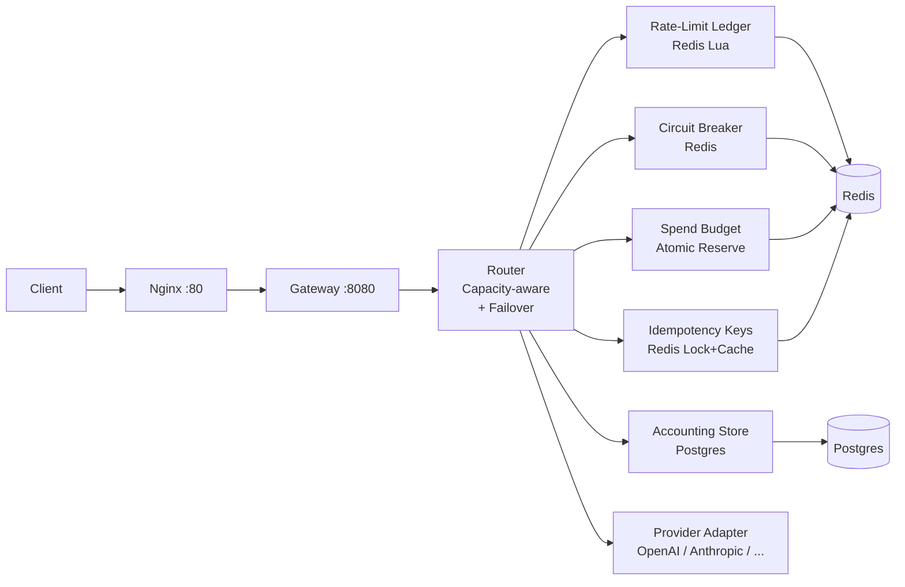

# Ultimate Free AI — Open-Source LLM Gateway

> **Production-ready LLM gateway** with capacity-aware routing, automatic failover, streaming SSE, per-credential budgets, idempotency, and full observability. Self-host in 2 minutes.

[](https://opensource.org/licenses/MIT)
[](https://github.com/rishu/Ultimate_frre_ai/actions)
[](https://hub.docker.com/r/rishu/ultimate-frre-ai)
[]()

---

## ✨ Features

| Feature | Description |
|---------|-------------|
| 🔀 **Capacity-Aware Routing** | Picks healthy credentials by RPM headroom; parks exhausted ones |
| 🔄 **Automatic Failover** | Retries on 429/5xx/timeout with credential ladder; 0% client-visible 429 |
| 🌊 **Streaming SSE** | Full OpenAI-compatible streaming through Nginx (no buffering) |
| 🛡️ **Per-Credential Budgets** | Atomic Lua reserve/reconcile/release; 429 before dispatch |
| 🔑 **Idempotency Keys** | Redis lock + response cache; single-flight for streaming & non-streaming |
| 📊 **Accounting & Telemetry** | One Postgres row per terminal path (success/failed/timeout/aborted) |
| 🧪 **Eval Harness** | 100 prompts, 4 buckets, deterministic self-graders, n=3 |
| 🏗️ **Policy Gate** | Pure `route()` function + JSON/eval stores; CI gate on policy regressions |

---

## 🚀 Quick Start (2 minutes)

### Prerequisites

- Docker Desktop (or Docker Engine + Compose plugin)
- Node.js 24+ (for local dev only)

### 1. Clone & Configure

```bash
git clone https://github.com/rishu/Ultimate_frre_ai.git
cd Ultimate_frre_ai
cp .env.example .env
# Edit .env: set ADMIN_TOKEN, add provider API keys
```

### 2. Launch Stack

```bash
docker compose --profile app up -d --wait
# → Postgres, Redis, Gateway, Nginx all healthy
```

### 3. Verify

```bash
curl http://localhost/healthz
# {"status":"ok","checks":{"redis":"ok","postgres":"ok"},"version":"1.0.0"}

# Streaming completion
curl -X POST http://localhost/v1/chat/completions \
  -H "Content-Type: application/json" \
  -H "Authorization: Bearer $ADMIN_TOKEN" \
  -d '{"model":"gpt-4o-mini","messages":[{"role":"user","content":"Hello"}],"stream":true}'
# → SSE chunks stream immediately
```

> ⚡ **Done!** Hit the API directly at `http://localhost`.

---

## 🏗️ Architecture



### Request Flow

```
client request (OpenAI format)
  → normalise to canonical schema
  → candidates = (model, credential) pairs with capacity left, breaker CLOSED
  → rank: capacity → task fit → LRU spread → quality
  → ATOMIC RESERVE (Redis Lua — the step that makes pooling work)
  → execute with failover ladder
       on 429 → park credential until retry-after, next candidate
       on 5xx/timeout → open breaker, next candidate
  → stream or buffer response
  → reconcile usage, emit one accounting event (finally)
```

> See [docs/architecture.md](docs/architecture.md) for the deep dive.

---

## 📊 Load Test Results (Block 16)

| Metric | Value | Target | Status |
|--------|-------|--------|--------|
| **Throughput multiplier vs single key** | **2.9x** | — | — |
| **Client-visible 429 rate** | **0.0%** | 0% | ✅ |
| **p95 proxy overhead** | **17.5ms** | <30ms | ✅ |
| **Failover success rate** | **100.0%** | >99.9% | ✅ |

*Run `npm run load` to reproduce. Mock upstream (60ms fixed latency) isolates gateway overhead. Full report: [load/report.md](load/report.md)*

---

## 🧪 Eval Results (Block 12)

| Bucket | Prompts | Grading Signal | Runs (n=3/cell) |
|--------|---------|----------------|-----------------|
| `json_extraction` | 25 | Validate against JSON Schema | 75 |
| `math` | 25 | Exact match | 75 |
| `code_generation` | 25 | Hidden unit tests, pass@1 | 75 |
| `structured_extraction` | 25 | Field-level exact match / F1 | 75 |
| **Overall** | **100** | **Deterministic self-graders** | **300** |

*Run `npm run eval` to reproduce. Full table: [docs/eval-table.md](docs/eval-table.md)*

---

## 🛠️ Development

```bash
# Local dev (no Docker)
npm run dev

# Gate — must pass before every PR
npm run verify          # typecheck → lint → format:check → unit tests

# Integration tests (needs docker compose up)
npm run test:int

# Load test (mock upstream, Artillery, 4 numbers)
npm run load

# Eval harness (100 prompts, n=3, markdown report)
npm run eval
```

| Command | What it does |
|---------|-------------|
| `npm run verify` | Typecheck + lint + format check + unit tests (fail-fast, <10s) |
| `npm run test:int` | Integration tests (needs `docker compose up`) |
| `npm run load` | Mock-upstream load test → 4 key numbers |
| `npm run eval` | Eval harness → markdown report |
| `npm run dev` | Dev server with file watching |
| `npm run build && npm start` | Production build and run |
| `npm run db:up` / `npm run db:down` | Postgres + Redis via Docker Compose |
| `npm run smoke` | Smoke test against running server |

---

## 🤝 Contributing

1. Fork → Branch: `git checkout -b feature/your-feature`
2. Run `npm run verify` — must pass
3. Submit PR with description
4. We respond within 48 hours

---

## 📄 License

MIT © [Priyanshu Raj](https://github.com/rishu)
