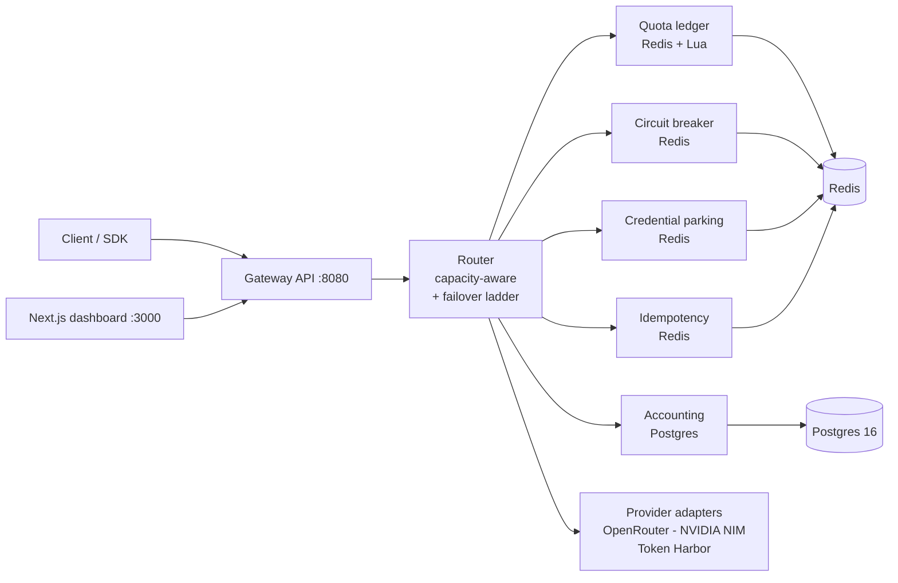

# LLM Gateway (BYOK)

> One OpenAI-compatible endpoint in front of **a pool of provider API keys you already own**. Rate-limit-aware routing, per-credential quota ledgers, automatic failover, and multiple keys per provider.


---

## Why this exists

Hosted LLM APIs throttle per *account*, and a single key is usually one strong model at roughly one request per couple of seconds. Cross that ceiling and the provider returns `429` until the window resets — but the ceiling, the window length and the reset behaviour differ per provider, per model, and change without notice.

The usual workarounds are all bad: sleep and retry, hardcode a second provider, or keep five keys in five `.env` files and pick one by hand, forgetting which is exhausted.

This gateway takes the keys you already have — several per provider, across several providers — and turns them into one endpoint with pooled capacity. It tracks remaining budget per `(credential, model, window)`, routes each request to a target that still has headroom, spreads load so one key is not exhausted while another idles, and fails over on `429` using the provider's own `Retry-After`.

**Rate limits are never hardcoded.** They are discovered at runtime and change monthly; a numeric RPM in the source would be wrong by the end of the quarter.

## What this is not

Stated plainly, because the distinction matters:

- **It does not create accounts.** No signup automation, no identity or fingerprint rotation, no proxy layer.
- **It does not hide traffic.** Requests identify themselves; the gateway does not try to look like many clients.
- **It honours provider back-off.** On `429` the credential is parked until the provider's own `retry-after`, then released. It does not retry into a limit.
- **It is only as good as the keys you bring.** If you supply keys from accounts created to evade a per-account cap, that can breach those providers' terms and get the keys banned. Nothing here changes that.

Pooling keys you legitimately control — a personal account, a work account, a second provider — is the intended use. Quota evasion is not.

---

## Features

| Feature | Description |
|---|---|
| **Bring your own keys** | Per-user provider keys, encrypted at rest with AES-256-GCM. No shared operator keys, no fallback. |
| **Multiple keys per provider** | Append a second, third, Nth key for one provider. Each becomes an independent credential with its own budget. |
| **Per-credential quota ledger** | One Redis key per `(credential, model, window)`; atomic reserve/reconcile/release in Lua. Refuses before dispatch, not after. |
| **Capacity-aware routing** | Ranks candidates availability -> task fit -> least-recently-used -> quality. Availability first, because 0 RPM of a brilliant model is useless. |
| **Automatic failover** | `429` parks the credential; `5xx`/timeout opens the breaker; the ladder moves to the next candidate. Streaming fails over only before the first token. |
| **Streaming (SSE)** | OpenAI-compatible streaming, unbuffered through the proxy. |
| **Per-key health** | `GET /v1/user/keys` reports each key as available or throttled, with a countdown. |
| **Idempotency keys** | Redis lock + response cache, single-flight across streaming and non-streaming. |
| **Accounting** | Exactly one Postgres row per terminal path — success, failure, timeout or abort — written in `finally`. |
| **Eval harness** | 100 prompts, 4 buckets, deterministic self-graders, n=3 per cell. |
| **Spend caps and organizations** | Per-user and per-organization budget ceilings. |
| **Dashboard** | Next.js keys page: add, list, health and per-key delete. |

---

## Architecture



### Request flow

```
client request (OpenAI wire format)
  -> normalise to the canonical schema
  -> candidates = (model, credential) pairs with headroom, breaker CLOSED
  -> rank: capacity -> task fit -> LRU spread -> quality
  -> ATOMIC RESERVE (one Redis Lua script - the step that makes pooling safe)
  -> execute with the failover ladder
       429         -> park that credential until its retry-after, next candidate
       5xx/timeout -> open the breaker for that target, next candidate
  -> stream or buffer the response
  -> reconcile usage, emit exactly one accounting row (finally)
```

### Adding a provider

One adapter file, plus one line in the registry. Nothing else changes — every CLI reads the same composition root, so a new provider reaches all of them without touching a script.

```
src/providers/types.ts       # the ProviderAdapter interface
src/providers/defaults.ts    # the single composition root
src/providers/<name>.ts      # your adapter
```

> Deep dive: [docs/architecture.md](docs/architecture.md) · provider notes: [docs/providers.md](docs/providers.md)

---

## Quick start

```bash
git clone https://github.com/NeverSpot/ultimate_free_AI_API.git
cd ultimate_free_AI_API
cp .env.example .env      # then set ADMIN_TOKEN, MASTER_ENCRYPTION_KEY, JWT_SECRET
npm ci
npm run sex               # docker (Postgres + Redis) -> migrate -> backend :8080 + frontend :3000
```

Or step by step:

```bash
npm run db:up             # Postgres :55432 + Redis :6379, waits for healthy
npm run db:migrate        # apply migrations
npm run dev               # backend on :8080
cd frontend && npm run dev # dashboard on :3000
```

Then:

```bash
curl http://localhost:8080/healthz

# Register, save a provider key, then chat
curl -X POST localhost:8080/v1/auth/register \
  -H 'Content-Type: application/json' \
  -d '{"username":"you","email":"you@example.com","password":"<your-password>"}'
```

Full walkthrough: [docs/usage-guide.md](docs/usage-guide.md)

### Prerequisites

Docker Desktop (or Docker Engine + Compose) and Node.js 24 or newer.

---

## Configuration

Copy `.env.example` to `.env`. **Never commit `.env`.**

| Variable | Required | Purpose |
|---|---|---|
| `ADMIN_TOKEN` | yes | Admin API access |
| `MASTER_ENCRYPTION_KEY` | yes | AES-256-GCM key for provider-key encryption (32+ chars) |
| `JWT_SECRET` | in production | HS256 session signing, 32+ chars |
| `DATABASE_URL` | yes | Postgres connection string (host port is **55432**, not 5432) |
| `REDIS_URL` | yes | Redis connection string |
| `PORT` | no | Gateway port, default **8080** |
| `LOG_LEVEL` | no | `info` by default |

Provider keys are **not** configured here in the BYOK path — each user submits their own through `POST /v1/user/keys`. The comma-separated `*_KEYS` variables in `.env.example` are an optional operator pool used only by the smoke and registry scripts.

---

## API surface

| Method | Path | Purpose |
|---|---|---|
| `POST` | `/v1/auth/register` · `/v1/auth/login` | Session cookie + gateway key |
| `GET` | `/v1/user/me` | Current session user |
| `GET` | `/v1/user/gateway-key` | Re-issue the same gateway key |
| `GET` | `/v1/user/keys` | List keys, each with health |
| `POST` | `/v1/user/keys` | Add a key (appends; `409` on duplicate) |
| `DELETE` | `/v1/user/keys/:provider/:keyId` | Remove one key |
| `POST` | `/v1/chat/completions` | OpenAI-compatible chat (streaming or buffered) |
| `GET` | `/v1/models` | Model discovery |
| `GET` | `/healthz` · `/metrics` | Health and Prometheus metrics |

> Reference: [docs/api.md](docs/api.md)

---

## Quality

`npm run verify` runs typecheck -> lint -> format check -> tests, and must exit 0.

| Gate | Result |
|---|---|
| `npm run verify` | **438 tests, 0 failures** |
| `npm run test:int` | Integration suites (needs `docker compose up`) |
| `cd frontend && npm run build` | Production build of the dashboard |

Measured by the repo's own harnesses, with a mock upstream to isolate gateway overhead:

| Benchmark metric | Value |
|---|---|
| Throughput multiplier vs a single key | **2.9x** |
| Client-visible `429` rate | **0.0%** |
| p95 proxy overhead | **17.5 ms** |
| Failover success rate | **100%** |

Reproduce: `npm run load` · `npm run eval` (100 prompts, 4 buckets, n=3 — table in [docs/eval-table.md](docs/eval-table.md))

> These are harness numbers against a mock upstream, not production traffic figures. The service has not been operated at scale.

---

## Repository layout

```
src/
  core/         canonical types, errors, execute loop (imports types only - no I/O)
  providers/    one file per provider + the registry
  credentials/  credential pool
  limits/       quota ledger (Redis Lua) + per-provider policy
  resilience/   circuit breaker, credential parking, retry-after parsing
  budget/       spend reservation
  routing/      candidate selection, free-model resolution, eval table
  http/         Fastify server, routes, middleware
  models/       Postgres stores (users, provider keys, organizations)
  telemetry/    metrics
  eval/         eval harness
frontend/       Next.js dashboard
migrations/     versioned SQL
docs/           architecture, API, providers, testing, ADRs
```

The **`core/` purity rule** is load-bearing: `core/` imports types and nothing else, which is what keeps routing testable with zero mocks — and a 438-test gate cheap enough to actually run on every change.

---

## Status

Actively developed. Phases A to I have landed: key aggregation, failover, accounting, evaluation, user identity, the provider-key vault, user-aware routing, the dashboard, and multi-key pooling.

Not yet done: capacity-aware sharding across a provider's keys beyond LRU spread, an admin panel, and a full observability stack.

## Contributing

Issues and pull requests are welcome. Run `npm run verify` before opening a PR — the gate is the contract, and a PR that does not pass it will not be reviewed.

## License

MIT — see [LICENSE](LICENSE).
